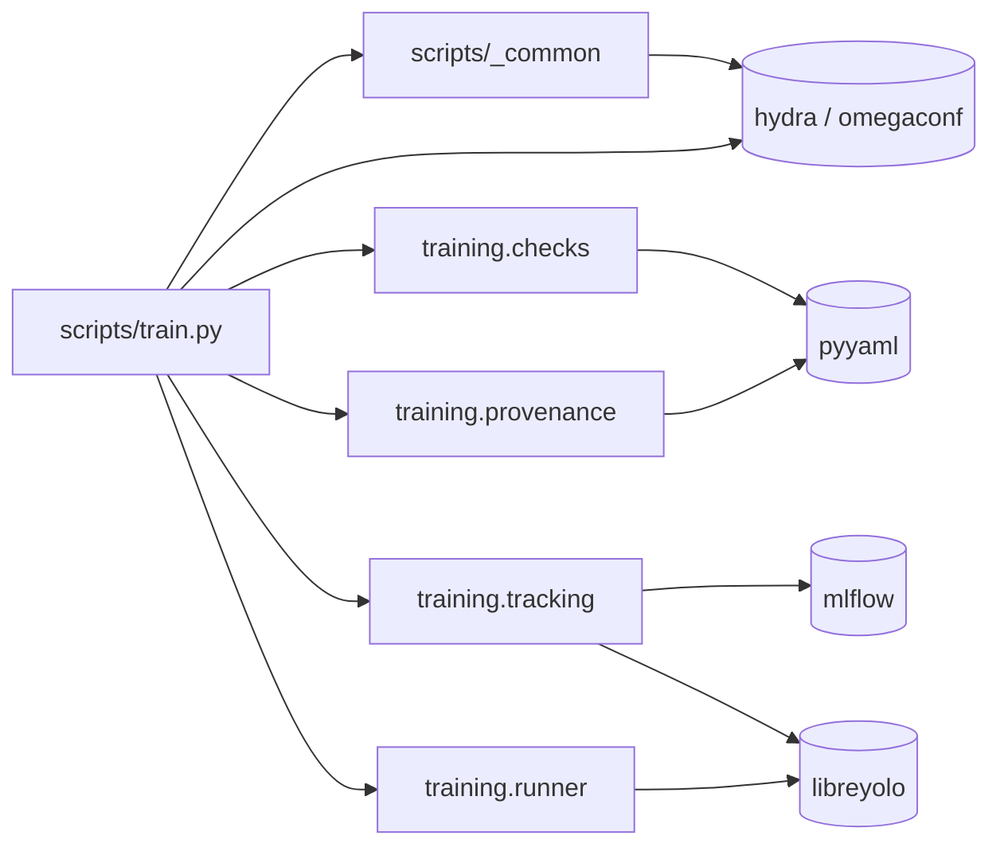
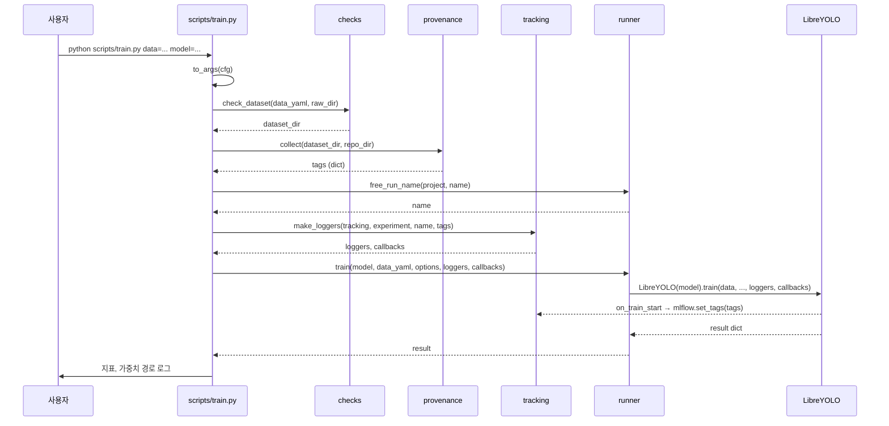
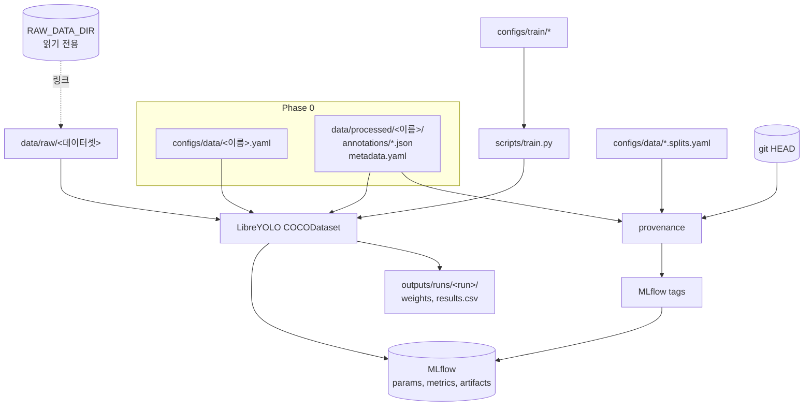
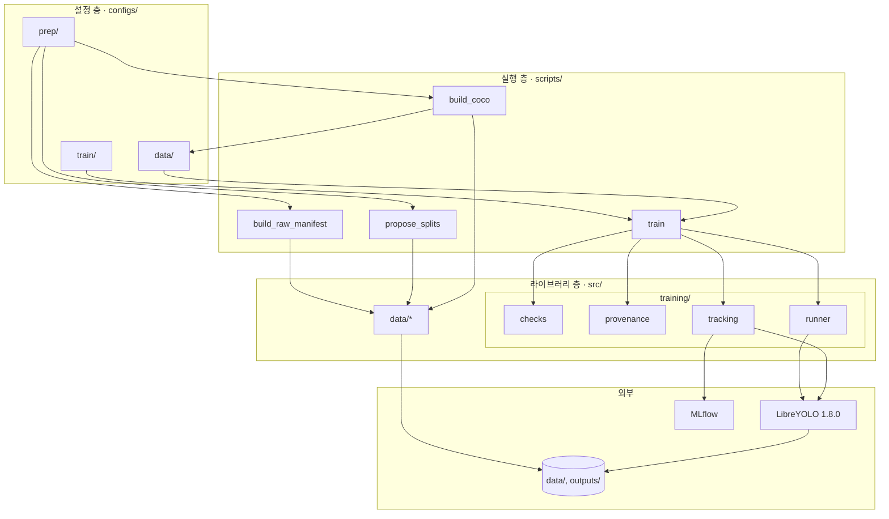

# Phase 1 학습 구조 설계

> [!note] 상태: 제안 (2026-11-26)
> 구현 전 설계안이다. 사용자 검토 후 확정한다.
> 확정되면 되돌리기 어려운 결정은 ADR로 남긴다.

## 1. 요구사항

### 1.1 기능 요구사항

| ID | 요구사항 |
|---|---|
| F1 | `build_coco`가 만든 데이터셋으로 검출 모델을 학습한다 |
| F2 | 모델, 데이터셋, 학습 값을 설정 파일로 고른다 |
| F3 | 명령줄에서 설정 값을 덮어쓴다 |
| F4 | 학습 지표와 설정을 MLflow에 기록한다 |
| F5 | 데이터 출처와 코드 출처를 run에 붙인다 |
| F6 | 중단된 학습을 이어서 한다 |
| F7 | mini 데이터셋으로 빠른 확인 학습(smoke)을 한다 |

### 1.2 비기능 요구사항

| ID | 요구사항 |
|---|---|
| N1 | 모든 실행은 Docker `lab`에서 한다 |
| N2 | LibreYOLO 패키지 코드는 고치지 않는다 |
| N3 | Hydra와 OmegaConf는 `scripts/`에서만 쓴다 ([ADR-0002](../../../adr/adr-0002-scripts-by-output-stage.md)) |
| N4 | 같은 설정과 seed면 같은 데이터 순서로 학습한다 |
| N5 | 학습 결과 이름이 겹치면 덮어쓰지 않는다 |
| N6 | `data/raw/<데이터셋>`은 심볼릭 링크로 둔다. 직접 마운트하면 시작 전 탐색이 3분 이상 걸린다 ([LibreYOLO #1078](https://github.com/LibreYOLO/libreyolo/issues/1078)) |

### 1.3 범위 밖

- 테스트 분할 평가와 checkpoint 비교: Phase 3.
- 추론과 API: Phase 2.
- 검출 외 작업: Phase 4.

## 2. 핵심 기능

1. 학습 실행: 설정을 읽고 LibreYOLO `train()`을 부른다.
2. 사전 점검: 데이터셋 YAML, COCO JSON, `data/raw/` 링크를 확인한다.
3. 출처 수집: 데이터셋 `metadata.yaml`, 분할 파일 해시, git 커밋을 모은다.
4. 실험 기록: `MLflowLogger`를 만들고 출처를 tag로 붙인다.
5. 결과 요약: 최종 지표와 가중치 경로를 로그에 남긴다.

## 3. 시스템 구성 요소

| 구성 요소 | 위치 | 역할 |
|---|---|---|
| 전처리 | `scripts/` 3개, `src/data/` | Phase 0. COCO 데이터셋과 YAML을 만든다 |
| 학습 스크립트 | `scripts/train.py` | Hydra 진입점. 설정을 값으로 풀어 라이브러리에 넘긴다 |
| 학습 라이브러리 | `src/training/` | 점검, 출처, 기록, 실행. Hydra를 모른다 |
| 학습 설정 | `configs/train/` | 모델, 학습 값, 기록 설정 |
| 데이터셋 설정 | `configs/data/<이름>.yaml` | `build_coco`가 만든다. 학습이 읽는다 |
| LibreYOLO | 패키지 `libreyolo==1.8.0` | 모델, 데이터 로딩, 학습 루프 |
| MLflow | 패키지 `mlflow` (`libreyolo[mlflow]`) | 실험 기록 저장소 |
| 결과 | `outputs/runs/<run>/` | 가중치, `results.csv` |

## 4. 디렉터리 구조

`+`는 새로 만든다.

```
configs/
├── data/                  # build_coco 산출물 (기존)
├── prep/                  # 전처리 설정 (기존)
└── train/                 # +
    ├── train.yaml         # + 기본 설정. defaults 목록
    ├── model/             # + yolox-s.yaml, yolo9-t.yaml ...
    ├── tracking/          # + mlflow.yaml, none.yaml
    └── experiment/        # + smoke.yaml, baseline.yaml
scripts/
├── _common.py             # 기존. setup_logging, to_args
└── train.py               # +
src/
├── data/                  # 기존
└── training/              # +
    ├── __init__.py
    ├── checks.py          # 사전 점검
    ├── provenance.py      # 데이터·코드 출처
    ├── tracking.py        # logger와 tag callback
    └── runner.py          # LibreYOLO 호출
outputs/runs/              # 학습 결과
```

`pyproject.toml`의 wheel 대상에 `src/training`을 추가한다.

## 5. 모듈별 책임

| 모듈 | 책임 | 하지 않는 것 |
|---|---|---|
| `scripts/train.py` | Hydra 설정 읽기, 값 풀기, 함수 순서대로 호출, 종료 코드 | 계산, 파일 쓰기 |
| `training.checks` | 데이터셋 YAML과 COCO JSON 존재 확인. `data/raw/` 항목이 링크인지 확인 | 이미지 열기 |
| `training.provenance` | `metadata.yaml` 읽기, 분할 파일 해시, git 커밋과 수정 여부 | MLflow 호출 |
| `training.tracking` | `MLflowLogger` 생성, `on_train_start` callback으로 tag 붙이기 | 학습 실행 |
| `training.runner` | 모델 생성, `train()` 호출, 결과 dict 반환. run 이름 충돌 처리 | 설정 해석 |

## 6. 모듈 간 의존성



- `src/training/`은 `src/data/`를 import하지 않는다. 둘은 파일(YAML, `metadata.yaml`)로만 연결된다.
- `src/training/` 모듈끼리는 서로 import하지 않는다. 스크립트가 반환값을 다음 함수로 넘긴다.
- `libreyolo`는 `tracking`과 `runner`만 import한다.

## 7. 함수 호출 관계



함수 시그니처 안:

```python
# training/checks.py
def check_dataset(data_yaml: Path, raw_dir: Path) -> Path

# training/provenance.py
def collect(dataset_dir: Path, repo_dir: Path) -> dict[str, str]

# training/tracking.py
def make_loggers(kind: str, experiment: str, run_name: str,
                 tags: dict[str, str], options: dict) -> tuple[list, list]

# training/runner.py
def free_run_name(project: Path, name: str) -> str
def train(model: str, data_yaml: Path, options: dict,
          loggers: list, callbacks: list) -> dict
```

## 8. 데이터 흐름



- 이미지는 `data/raw/` 링크를 따라 원본에서 읽는다. 복사하지 않는다 ([ADR-0001](../../../adr/adr-0001-coco-json-labels.md)).
- 라벨은 `data/processed/<이름>/annotations/<분할>.json`에서 읽는다.
- 학습은 `data/processed/`와 `configs/data/`를 읽기만 한다.

## 9. Configuration 관리 구조

`configs/train/train.yaml` 안:

```yaml
defaults:
  - /prep/common@_here_        # 로그 설정, Hydra 출력 끄기 재사용
  - model: yolox-s
  - tracking: mlflow
  - _self_
  - optional experiment: null

data: aihub101-ped-mini        # configs/data/<data>.yaml
name: ${model.id}_${data}      # run 이름. 겹치면 -v2, -v3
project: outputs/runs
seed: 0
train:                         # LibreYOLO train()에 그대로 넘긴다
  epochs: 100
  batch: 16
  imgsz: 640
  workers: 4
  amp: true
  patience: 50
```

- 설정 그룹은 `model`, `tracking`, `experiment` 3개다.
- `train:` 아래 키는 LibreYOLO `train()` 키워드와 같은 이름을 쓴다. 스크립트가 해석하지 않고 넘긴다.
- `experiment/smoke.yaml`은 `data`, `train.epochs`만 덮어쓴다.
- 최종 설정은 `--cfg job`으로 본다. MLflow params에도 남는다.
- `--cache`는 설정에 두지 않는다. `false`로 고정한다(원본이 읽기 전용).

> [!question] `configs/prep/common.yaml` 공유
> 전처리와 학습이 같은 공통 설정을 쓸지 정해야 한다.
> 나누면 `configs/common.yaml`로 옮긴다.

## 10. LibreYOLO 연동 지점

| 지점 | LibreYOLO API | 우리 쪽 | 비고 |
|---|---|---|---|
| 모델 생성 | `LibreYOLO(model_path)` | `runner.train` | 가중치는 `weights/`에 내려받는다 |
| 학습 | `model.train(data, *, epochs, batch, imgsz, seed, project, name, resume, callbacks, loggers, **kwargs)` | `runner.train` | `exist_ok=False` 유지 |
| 데이터 로딩 | `load_data_config`, `COCODataset` | 데이터셋 YAML | `annotations` 키가 있으면 COCO를 쓴다 |
| 실험 기록 | `libreyolo.training.MLflowLogger` | `tracking.make_loggers` | CLI에는 logger 옵션이 없다 |
| callback | `on_train_start`, `on_train_epoch_end`, `on_train_end`, `on_train_exception` | `tracking` | 앞의 세 hook 예외는 학습을 끝낸다 |
| 이어하기 | `train(resume=True)` | `scripts/train.py resume=true` | 같은 run 이름을 쓴다 |
| 검증 | `model.val(data, split=...)` | Phase 3 | Phase 1은 학습 중 val만 쓴다 |

> [!warning] 알려진 제약
> `load_data_config`는 COCO를 써도 분할 이미지 폴더를 탐색한다.
> `data/raw/` 항목이 링크면 탐색 결과가 0장이고 빠르다.
> 이 동작에 기대므로 `checks`가 링크인지 확인한다. ([#1078](https://github.com/LibreYOLO/libreyolo/issues/1078))

## 11. 소프트웨어 아키텍처



## 12. 정해야 할 것

- [ ] MLflow 저장소와 artifact 위치 ([libreyolo-mlflow 6절](libreyolo-mlflow.md#6-정해야-할-것)).
- [ ] run 이름 규칙. 안: `<모델>_<데이터셋>`, 겹치면 `-vN`.
- [ ] 첫 기준 모델. 안: `yolox-s` (학습 확인됨).
- [ ] `configs/prep/common.yaml`을 공유할지.
- [ ] git 수정 상태에서 학습을 막을지, tag만 남길지.

관련 페이지: [libreyolo-models](libreyolo-models.md), [libreyolo-mlflow](libreyolo-mlflow.md), [libreyolo-dataset-formats](../../phase_0/concepts/libreyolo-dataset-formats.md)
